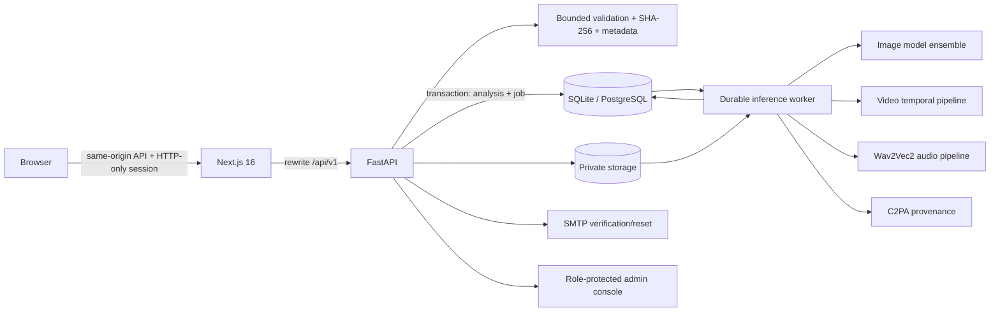

# CGS DeepFake Shield

## Project Profile and Technical Overview

**Version:** 1.6.0  
**Tagline:** *Inspect the image. Examine the evidence.*  
**Category:** AI-powered synthetic-media forensics and deepfake screening platform

---

## 1. Project Name

**CGS DeepFake Shield**

CGS DeepFake Shield is a local-first, multi-modal media-forensics workspace for screening images, videos, and audio for signs of synthetic generation or manipulation. It combines cryptographic file-integrity checks, C2PA Content Credentials verification, frequency-domain analysis, and an agreement-aware ensemble of deep-learning models into a single evidence-grade report.

The platform is designed for responsible, human-in-the-loop verification. It does **not** claim to provide absolute proof that media is fake or authentic. Instead, it presents independent forensic signals, model outputs, confidence levels, technical limitations, and an explicit `inconclusive` outcome when the evidence is weak or contradictory.

---

## 2. Abstract

The rapid spread of generative AI has made it possible to create convincing fake images, videos, and voices at almost zero marginal cost. Deepfakes are now used in misinformation campaigns, financial fraud, identity theft, harassment, non-consensual imagery, and reputational attacks. Traditional media-verification workflows are poorly equipped for this threat: manual review is slow and expensive, single-model detectors are brittle and opaque, and many commercial detection APIs require uploading sensitive media to third-party cloud services.

CGS DeepFake Shield addresses this gap with a privacy-preserving, multi-signal forensic platform. Every upload is validated and sanitized, fingerprinted with SHA-256, stored in private storage, and processed by a durable background worker. The worker runs independent evidence layers: file-integrity and metadata inspection, C2PA provenance verification, 2D FFT spectral analysis, image-model ensembles, temporal video analysis, and audio anti-spoofing. Model outputs are calibrated and combined conservatively; if the models disagree, if too few models are healthy, or if the score falls inside the ambiguity band, the platform reports `inconclusive` instead of forcing a verdict. Every report records the exact model identities, score semantics, thresholds, limitations, and provenance state, producing an auditable chain of evidence suitable for journalists, investigators, compliance teams, and researchers.

The system is built as a production-oriented monorepo: a Next.js 16 / React 19 frontend, a FastAPI / SQLAlchemy backend, a database-backed worker with leases and retries, PostgreSQL row-level security, Argon2id authentication, rate limiting, an administrator console, and deployment paths for local Windows, Docker Compose, and Vercel. All model inference runs locally and offline, with model artifacts pinned by commit hash and verified by SHA-256 before loading.

---

## 3. Problem Statement

### 3.1 The Deepfake Threat Is Now Operational, Not Theoretical

Generative models can produce realistic faces, voices, and scenes from short prompts or a handful of samples. The cost of creating a convincing fake has collapsed, while the cost of verifying one remains high. This asymmetry creates several concrete problems:

- **Misinformation and election interference:** fabricated speeches, events, and official statements can spread faster than fact-checkers can respond.
- **Financial fraud:** voice cloning and video impersonation are used to authorize payments, bypass KYC checks, and impersonate executives.
- **Harassment and abuse:** non-consensual intimate imagery and targeted reputational attacks cause severe psychological and social harm.
- **Evidence integrity:** courts, newsrooms, insurers, and HR teams increasingly receive media whose origin and editing history are unclear.
- **Platform trust:** social networks and marketplaces struggle to distinguish authentic user content from synthetic or manipulated media at scale.

### 3.2 Existing Detection Tools Have Structural Weaknesses

- **Single-model fragility:** one classifier trained on one generator family often fails on unseen generators, heavy compression, or small manipulated regions.
- **Opaque scoring:** a bare "97% fake" percentage does not explain which signal drove the result, what the model was trained on, or how reliable it is.
- **Overconfidence:** many tools present probabilistic outputs as definitive conclusions, creating legal, ethical, and reputational risk.
- **Cloud dependency and privacy loss:** uploading sensitive imagery or voice recordings to a third-party API introduces confidentiality, residency, and retention concerns.
- **Single-modality design:** image-only tools miss synthetic audio and temporal video inconsistencies; audio-only tools miss visual manipulation.
- **Missing provenance context:** platforms frequently strip EXIF and C2PA metadata, so the absence of provenance is common and must not be treated as proof of manipulation.
- **Operational immaturity:** many research prototypes lack secure authentication, audit trails, abuse controls, durable job processing, or deployment documentation.

### 3.3 The Core Gap

There is a need for a verification platform that is:

1. **Multi-signal** rather than dependent on one model.
2. **Explainable and auditable** rather than a black-box score.
3. **Privacy-preserving** rather than cloud-dependent.
4. **Conservative** rather than overconfident.
5. **Operationally complete** enough to run securely in real environments.

CGS DeepFake Shield is built around that gap.

---

## 4. Proposed Solution

### 4.1 Solution Overview

CGS DeepFake Shield is a secure forensic workspace that turns an uploaded media file into a structured, evidence-grade report. Rather than asking one detector to "decide," the platform separates the investigation into independent layers, each answering a different question:

| Layer | Question It Answers | Output |
|---|---|---|
| File integrity | Has the byte stream changed, and what is it structurally? | SHA-256 digest, format, dimensions, EXIF/ICC presence |
| Provenance | Does the file carry verifiable C2PA Content Credentials? | Trusted / valid-untrusted / invalid / not present / unavailable |
| Spectral analysis | Are there frequency-domain artifacts associated with generation or upscaling? | High/low-frequency power, drift ratio, dispersion |
| Image ensemble | Do independent vision models detect synthetic patterns? | Per-model scores, calibrated ensemble score, agreement |
| Video temporal | Do sampled frames show spatial or cross-frame inconsistency? | Keyframe timeline, spatial mean/peak, temporal LSTM score |
| Audio anti-spoofing | Does the speech contain vocoder or synthetic-voice artifacts? | Window-level scores, composite audio score |
| Metadata / technical integrity | What can be observed without over-claiming? | Format facts, dimensions, hashes, metadata presence |

The final report combines these signals into a verdict band: `likely_manipulated`, `likely_authentic`, or `inconclusive`. The platform treats `inconclusive` as a valid and responsible result.

### 4.2 End-to-End Workflow

1. **Upload and validation** — The user submits an image, video, or audio file. The API enforces per-file and per-pixel limits, checks magic bytes, validates the decoded container, rejects animated images and unsupported formats, and sanitizes images by re-encoding them to a clean RGB representation.
2. **Fingerprinting and private storage** — A SHA-256 digest is computed. The original and a normalized preview are stored under generated keys in private storage outside the web root.
3. **Transactional job creation** — The analysis record and an `InferenceJob` row are inserted in the same database transaction, so a queued report can never exist without a job or vice versa.
4. **Durable worker processing** — A database-backed worker claims the job with a conditional update and an expiring lease. Crashed workers can be recovered by another worker after lease expiry.
5. **Evidence collection** — The worker runs C2PA verification and the appropriate modality pipeline:
   - **Image:** multi-model ViT ensemble + 2D FFT spectral analysis.
   - **Video:** uniform keyframe sampling → per-frame image ensemble → optional audio-track extraction → temporal ResNeXt50 + LSTM inference.
   - **Audio:** safe FFmpeg conversion to mono 16 kHz PCM WAV → Wav2Vec2 sliding-window analysis.
6. **Calibrated synthesis** — Model probabilities are calibrated with Platt-style scaling, weighted, and checked for inter-model agreement. Disagreement or insufficient healthy models forces `inconclusive`.
7. **Report generation** — The report exposes per-model scores, latency, score semantics, threshold policy, provenance state, technical integrity, warnings, and limitations. It is printable to an A4-friendly PDF.
8. **Retention and deletion** — Users can delete individual reports or their account. A worker cleanup task removes expired completed/failed reports and their private files according to the configured retention policy.

### 4.3 How the Solution Addresses the Problem

| Problem | CGS DeepFake Shield Response |
|---|---|
| Single-model fragility | Independent ViT ensemble, optional hybrid model, temporal model, and audio model |
| Opaque scoring | Per-model breakdown, calibrated scores, agreement metric, thresholds, and plain-language limitations |
| Overconfidence | Conservative verdict bands; disagreement forces `inconclusive`; no absolute "100% real/fake" claims |
| Privacy loss | Local CPU/GPU inference; no media sent to a hosted model API; private storage |
| Single-modality blind spots | Unified image, video, and audio pipeline plus provenance and spectral analysis |
| Missing metadata misread as fake | C2PA/EXIF are reported as separate evidence sources, never as proof of manipulation |
| Operational gaps | Authentication, email verification, rate limits, IP abuse controls, audit logs, admin console, durable queue, health checks, and deployment paths |
| Supply-chain risk | Pinned model revisions, SHA-256 verification, SafeTensors-only loading, no `trust_remote_code`, offline inference |
| Unreliable job processing | Transactional job creation, conditional claims, leases, bounded retries, heartbeats, crash recovery |
| False accusations | Human-in-the-loop language and explicit warnings against using reports as sole evidence in legal or high-impact decisions |

---

## 5. What Is Innovative About It

### 5.1 Segregated Evidence Architecture

Most detection tools collapse every signal into a single opaque score. CGS DeepFake Shield deliberately keeps evidence layers separate: file integrity, provenance, spectral artifacts, image-model consensus, temporal consistency, and audio anomalies each report their own observations and limitations. This makes the result explainable, contestable, and auditable.

### 5.2 Agreement-Aware Conservative Ensemble

The ensemble does not simply average model outputs. It:

- Calibrates each model's raw probability.
- Applies model-specific weights.
- Computes inter-model standard deviation.
- Forces `inconclusive` when models disagree beyond a defined threshold.
- Forces `inconclusive` when fewer than two image models are healthy.
- Uses explicit score bands rather than a binary fake/real switch.

This "disagreement is itself evidence" design is a meaningful departure from overconfident single-score detectors.

### 5.3 Multi-Modal Forensics in One Workspace

The platform unifies:

- Image deepfake screening.
- Video keyframe and temporal analysis.
- Audio deepfake and speech anti-spoofing.
- C2PA Content Credentials verification.
- 2D FFT spectral analysis.
- File-integrity and metadata inspection.

Few open or academic projects combine all of these into one cohesive, deployable workflow with a shared report format.

### 5.4 Cryptographic Chain of Custody and Model Supply-Chain Security

The system treats models and media as evidence:

- Every upload receives a SHA-256 digest.
- Model files are pinned to exact revisions and verified against `models.lock.json` before loading.
- Model weights use SafeTensors or ONNX; pickle checkpoints and remote Python code are avoided.
- Runtime inference is offline (`HF_HUB_OFFLINE`, `TRANSFORMERS_OFFLINE`).
- The report records model identity, version, threshold policy, score semantics, and inference latency.

This level of supply-chain discipline is uncommon in student or prototype deepfake projects.

### 5.5 Privacy-First, Local-First Inference

Media never has to leave the operator's environment for inference. The platform can run on a laptop with SQLite and local storage, or on a PostgreSQL-backed server with isolated API and worker processes. This is a strong differentiator for journalists, lawyers, clinics, and organizations handling sensitive media.

### 5.6 Durable Database-Backed Job Queue Without Redis

Instead of relying on in-process background tasks or an external message broker, the platform stores jobs in SQL alongside the analysis row and uses conditional updates, expiring leases, bounded retries, and worker heartbeats. This provides crash recovery and multi-worker safety with only the primary database.

### 5.7 Evidence-Grade Reporting

Reports include:

- Case/report ID and timestamps.
- SHA-256 integrity digest.
- Original file facts and normalized preview.
- Per-model scores and latency.
- Ensemble score and confidence band.
- Spectral metrics.
- Frame timeline for video.
- Audio window statistics.
- C2PA/provenance state.
- Explicit warnings and limitations.
- Print-to-PDF layout suitable for case files.

This turns a model output into a reviewable forensic artifact.

### 5.8 Responsible AI as a Product Principle

The platform is designed around "show the work, keep uncertainty visible, people make the call." Unavailable models are labeled unavailable. Missing provenance is not treated as manipulation. Model scores are not presented as population probabilities. Inconclusive is a first-class outcome. This is a mature and defensible approach to a high-stakes domain.

### 5.9 Secure-by-Default Product Engineering

Beyond the AI, the project implements:

- Argon2id password hashing and opaque HTTP-only sessions.
- SHA-256 session-token digests at rest.
- Email verification and password-reset token flows.
- Persistent rate limits with HMAC-digested keys.
- IP-based account-abuse controls with admin review.
- PostgreSQL forced row-level security.
- Same-origin mutation checks and Fetch Metadata checks.
- CSP, HSTS, `nosniff`, frame denial, and permissions policy.
- A private-by-default API with a startup route check.
- A role-protected admin console with audit logging.
- Separate migration and runtime database roles in Docker Compose.

This makes the project a complete product architecture rather than a model demo.

---

## 6. Social Impact

### 6.1 Fighting Misinformation and Protecting Public Trust

CGS DeepFake Shield gives journalists, fact-checkers, election monitors, and civil-society organizations a structured way to examine suspicious media. By showing which signals were checked and where uncertainty remains, it supports accurate reporting and reduces the risk of amplifying fabricated content.

### 6.2 Protecting Individuals from Harassment and Abuse

Deepfake-based harassment disproportionately affects women, public figures, and vulnerable communities. A privacy-preserving verification tool helps victims, advocates, and platforms document synthetic media without handing sensitive files to an unknown cloud service.

### 6.3 Supporting Justice and Accountability

Courts, legal teams, insurers, and human-rights investigators need more than a percentage score. They need an auditable record of what was examined, which models were used, what the limitations were, and how the conclusion was reached. CGS DeepFake Shield's chain-of-custody design and printable reports support that need.

### 6.4 Reducing Wrongful Accusations and Automation Bias

A major social risk of deepfake detection is the false positive: labeling authentic media as fake, or treating a model score as proof. The platform explicitly counters this by:

- Using conservative verdict bands.
- Forcing `inconclusive` when models disagree.
- Documenting model limitations and score semantics.
- Warning against using reports as sole evidence in legal, employment, or financial decisions.
- Keeping a human reviewer in the loop.

This helps prevent technology from becoming a source of new injustice.

### 6.5 Democratizing Access to Forensic Tools

Commercial media-forensics services can be expensive and opaque. A local-first, open, self-hostable platform lowers the barrier for smaller newsrooms, NGOs, universities, and independent researchers. It also works in environments where cloud upload is not permitted or connectivity is limited.

### 6.6 Building Digital Literacy

The report design teaches users how to think about evidence: hashes, metadata, provenance, model agreement, uncertainty, and limitations. This contributes to a broader culture of critical media consumption.

---

## 7. Economic Impact

### 7.1 Reducing Losses from Deepfake-Enabled Fraud

Deepfake voice and video are increasingly used in payment fraud, CEO impersonation, identity verification bypass, and insurance claims. Faster, structured screening can help organizations flag suspicious media before financial damage occurs and can support post-incident investigations.

### 7.2 Lowering the Cost of Media Verification

Manual forensic review is time-intensive and requires specialized expertise. CGS DeepFake Shield automates the first-pass triage, giving analysts a structured report to review instead of starting from scratch. Local inference also avoids per-scan API fees and repeated cloud egress costs.

### 7.3 Enabling New Verification Services

The platform can serve as the technical foundation for:

- Newsroom verification desks.
- Legal and insurance forensics.
- Compliance and KYC review.
- Brand and reputation monitoring.
- Social-platform trust and safety workflows.
- Academic research on synthetic-media detection.

This creates opportunities for verification-as-a-service offerings, consulting, and specialized forensic products.

### 7.4 Protecting Brand and Platform Value

Platforms and advertisers lose trust when synthetic content pollutes feeds or marketplaces. A transparent screening layer can reduce moderation risk, protect advertising integrity, and demonstrate responsible platform governance to regulators and users.

### 7.5 Reducing Vendor Lock-In and Data-Residency Costs

Because inference can run on local infrastructure, organizations can avoid long-term dependence on proprietary detection APIs and keep sensitive media within their own jurisdiction and security boundary. This can reduce legal, procurement, and data-transfer overhead.

### 7.6 Supporting High-Skill Job Creation

The platform creates demand for roles in AI assurance, forensic analysis, trust and safety, cybersecurity, and model evaluation. Its explainable design also makes it easier to train junior analysts, because the report shows the reasoning trail rather than a single opaque score.

### 7.7 Commercial Potential

The architecture is suitable for a freemium or enterprise model:

- **Individual / prosumer:** limited reports, private history, print-ready reports.
- **Professional:** higher limits, team workspaces, audit exports, priority processing.
- **Enterprise / public sector:** self-hosted deployment, SSO, custom retention, compliance integrations, dedicated support.

Because the core inference stack is local and the platform already includes authentication, administration, audit logs, and deployment tooling, the path from prototype to commercial product is relatively short.

---

## 8. Technology Used

### 8.1 Technology Stack by Layer

| Layer | Technologies | Purpose |
|---|---|---|
| **Frontend** | Next.js 16.4 (App Router), React 19.3, TypeScript 6, Motion, custom CSS design system | Public site, authentication, analysis workspace, report viewer, admin console |
| **Backend API** | Python 3.11+, FastAPI, Pydantic v2, Uvicorn, SQLAlchemy 2, Alembic | REST API, request validation, authorization, migrations |
| **Database** | SQLite (local development), PostgreSQL 16 (production) | Users, sessions, analyses, jobs, rate limits, audit logs, admin data |
| **AI / ML runtime** | PyTorch, TorchVision, Hugging Face Transformers, SafeTensors, ONNX Runtime | Local model loading and inference |
| **Image models** | ViT-Base/16 ensembles, optional EfficientNetV2-S + Swin-V2-T hybrid, ONNX FP16 CNN | Synthetic-image and deepfake screening |
| **Video model** | ResNeXt50 + LSTM temporal head | Cross-frame video inconsistency analysis |
| **Audio model** | Wav2Vec2 speech classification | Synthetic voice / audio anti-spoofing |
| **Signal analysis** | NumPy, 2D FFT, spectral power metrics | Frequency-domain artifact inspection |
| **Media processing** | Pillow, OpenCV (headless), FFmpeg | Bounded image decoding, video frame sampling, audio normalization |
| **Provenance** | C2PA Python SDK, JUMBF/Content Credentials | Manifest validation and provenance reporting |
| **Authentication** | Argon2id (`argon2-cffi`), opaque session cookies, SHA-256 token digests | Secure account and session handling |
| **Security** | HMAC rate-limit keys, PostgreSQL row-level security, CSP/HSTS, same-origin checks | Abuse prevention and defense in depth |
| **Worker / queue** | Custom database-backed worker, leases, retries, heartbeats | Durable asynchronous inference |
| **Email** | SMTP relay | Verification and password-reset links |
| **Deployment** | PowerShell launcher, Docker, Docker Compose, Vercel | Local, containerized, and frontend-hosted deployment |
| **Testing / QA** | pytest, Playwright, ESLint, TypeScript compiler, Ruff | Backend, browser, lint, and type verification |

### 8.2 Model Portfolio

| Model / Component | Architecture | Input | Role | Status |
|---|---|---|---|---|
| `dima806/deepfake_vs_real_image_detection` | Vision Transformer (ViT-Base/16) | 224 × 224 RGB | Image deepfake screening | Active in ensemble |
| `prithivMLmods/Deep-Fake-Detector-v2-Model` | Vision Transformer (ViT-Base/16) | 224 × 224 RGB | Image deepfake screening | Active in ensemble |
| `Harshasnade/Deepfake_Detection_System_V1` | EfficientNetV2-S + Swin-V2-T + FFT branch + patch branch | 256 × 256 RGB | Hybrid spatial/frequency/patch analysis | Vendored; disabled by default due to unspecified upstream license |
| `Thermostatic/community-forensics-low-quality-detector-2026-08` | ONNX FP16 spatial CNN + 2D FFT | 384 × 384 RGB | Whole-image AI-generation screening / forensic fallback | Hash-pinned; available |
| `Naman712/Deep-fake-detection` | ResNeXt50 + LSTM | 20 frames × 112 × 112 | Video temporal inconsistency | Optional; gated checkpoint requires Hugging Face access |
| `Vansh180/deepfake-audio-wav2vec2` | Wav2Vec2 sequence classifier | Mono 16 kHz audio, 4 s windows | Audio deepfake / voice anti-spoofing | Active when weights are present |
| C2PA Content Credentials | CAI `c2pa-python` SDK | Embedded manifest | Provenance verification | Optional; reports unavailable if SDK is absent |
| Spectral analysis | 2D FFT magnitude spectrum | 256 × 256 grayscale | Frequency-domain artifact signal | Always computed for images |

### 8.3 Ensemble and Verdict Logic

- **Calibration:** Platt-style logit scaling with model-specific parameters.
- **Weights:** image models use configurable weights (e.g., 0.40 / 0.40 / 0.20).
- **Agreement:** standard deviation across calibrated image-model scores.
- **Image verdict bands:**
  - `likely_manipulated`: weighted score ≥ 0.65 with low disagreement.
  - `likely_authentic`: weighted score ≤ 0.35 with low disagreement.
  - `inconclusive`: score in the 0.35–0.65 band, disagreement ≥ 0.35, or fewer than two healthy models.
- **Video composite:** 50% mean frame score + 25% peak frame score + 25% audio score when audio exists; otherwise 65% mean + 35% peak.
- **Audio verdict:** 0.65 / 0.35 bands with confidence levels.
- **Failure behavior:** missing or failed models produce no fabricated score; the report states what is unavailable.

### 8.4 Security and Privacy Technologies

- Argon2id password hashing with a 15-character minimum passphrase.
- Opaque HTTP-only session cookies; only SHA-256 token digests stored server-side.
- Signed, opaque guest cookie for guest-owned reports; no browser fingerprinting.
- Persistent fixed-window rate limiting with HMAC-digested keys.
- IP-based account limits with soft/hard block modes, allowlists, and unblock workflow.
- PostgreSQL `ENABLE` + `FORCE ROW LEVEL SECURITY` for users, sessions, analyses, jobs, and audit events.
- Private-by-default `/api/v1` routing with a fail-closed startup route check.
- CSP, HSTS in production, `X-Content-Type-Options: nosniff`, frame denial, referrer policy, and permissions policy.
- Bounded file decoding, decompression-bomb protection, magic-byte validation, and safe FFmpeg subprocess execution.
- Model lockfile with SHA-256 verification and offline inference enforcement.
- Administrator console with role checks, one-time invitations, audit logs, and noindex/private caching.

### 8.5 Deployment and Operations

- **Local:** one PowerShell command (`.\run.ps1`) prepares dependencies, applies migrations, verifies/downloads the model, and starts the API, worker, and frontend.
- **Docker Compose:** PostgreSQL 16, FastAPI API, inference worker, and Next.js web service with separate migration/runtime database roles and private volumes.
- **Vercel:** Next.js frontend with same-origin `/api` rewrites. The Python API and inference worker can be hosted separately (Docker/VM) or mapped as a Vercel service; production configuration validates the required API origin at build time.
- **Health:** `/health/live`, `/health/ready`, `/healthz`, and `/readyz` endpoints; worker heartbeats visible to administrators.
- **Observability:** worker queue depth, lease recovery, retry/failure states, detector health, admin audit events, and safe error codes.

---

## 9. System Architecture

### Trust Boundaries

1. Browser input, file bytes, filenames, metadata, and credentials are untrusted.
2. The API validates and sanitizes media before storage or inference.
3. The worker runs separately from the web/API process and claims jobs through the database.
4. Every report, preview, deletion, and admin action is authorized server-side.
5. Model artifacts are verified against a cryptographic lockfile before loading.
6. All inference is local; no remote model API receives user media.

---

## 10. Core Modules

| Module | Responsibility |
|---|---|
| **Public website** | Home, solutions, technology, how-it-works, about, contact, privacy, terms |
| **Authentication** | Sign-up, sign-in, email verification, password reset, guest identity, sessions |
| **Analysis workspace** | Upload, type verification, neural scan overlay, report history, settings |
| **Report viewer** | Verdict, model breakdown, spectral metrics, frame timeline, audio analysis, provenance, warnings, print-to-PDF |
| **API service** | Validation, authorization, rate limits, report CRUD, admin endpoints, health checks |
| **Inference worker** | Job claiming, leases, retries, modality routing, ensemble synthesis, cleanup |
| **Model registry** | Warm singleton loading, health checks, lockfile verification, offline enforcement |
| **Model adapters** | ViT, hybrid CNN/Transformer, ONNX, Wav2Vec2, temporal ResNeXt50+LSTM |
| **Ensemble engine** | Calibration, weighted aggregation, agreement checks, verdict bands |
| **Provenance scanner** | C2PA manifest reading and privacy-conscious summaries |
| **Media safety** | Magic-byte checks, bounded decode, sanitization, FFmpeg, frame/audio extraction |
| **Admin console** | Users, inspection ledger, queue, contact inbox, admins, activity logs, traffic controls, platform settings |
| **Database layer** | SQLAlchemy models, Alembic migrations, row-level security, audit records |
| **Deployment tooling** | `run.ps1`, Dockerfiles, Compose, Vercel configuration |

---

## 11. Verification and Quality Assurance

The repository includes a documented verification and audit report covering:

- Multi-model image ensemble and audio pipeline implementation.
- Model supply-chain pinning and SHA-256 lockfile verification.
- Media validation, sandboxed FFmpeg execution, and private storage lifecycle.
- Verdict calibration and conservative fallback behavior.
- Authentication, session hardening, security headers, and rate limiting.
- Backend test suite, Ruff linting, TypeScript type checking, ESLint, and Playwright browser journeys.

The documented backend run recorded:

- **49 tests total**
- **47 passed**
- **1 skipped** (live ONNX benchmark requiring optional acceleration)
- **1 deselected** (archived legacy migration test)
- **0 failed**
- Ruff: **0 errors**
- TypeScript: **0 type errors**
- ESLint: **0 warnings/errors**

The platform also includes Playwright journeys for signup, upload, durable processing, report evidence, deletion, admin access, and rejection of non-admin users from admin routes.

> Verification results are environment- and date-specific. Treat the repository's verification report as documented evidence, not a permanent guarantee. Model accuracy is not independently reproduced by this project.

---

## 12. Limitations and Responsible-Use Boundaries

CGS DeepFake Shield is intentionally explicit about what it does **not** do:

- It is **not** proof that media is fake or authentic.
- It is **not** a universal deepfake detector.
- It is **not** a face-swap or localized-manipulation detector.
- It is **not** a population-calibrated probability engine.
- It does **not** treat missing metadata or missing C2PA as evidence of manipulation.
- It does **not** use uploaded media for model training.
- It does **not** send media to a hosted inference provider.
- It does **not** replace human judgment in legal, journalistic, employment, financial, or safety-critical decisions.

Known technical limits include:

- Adversarial laundering, extreme compression, screenshots, small composites, and unseen generators can evade detection.
- Video temporal inference requires a gated upstream checkpoint; without it, the layer reports unavailable and emits no score.
- C2PA verification depends on the optional SDK and the deployment's trust configuration.
- Audio analysis needs sufficient duration and signal; silence or very short clips return an `insufficient_audio` result.
- Docker Compose and PostgreSQL deployment paths are provided as production starting points but require operator hardening, monitoring, backups, and legal/privacy review.
- Model accuracy claims originate from upstream model authors; this project does not independently reproduce them.

These limits are not hidden in fine print. They are part of the product's report language and design philosophy.

---

## 13. Future Scope

Potential extensions that fit the existing architecture:

1. **Manipulation localization** — heatmaps showing which regions or frames triggered a signal.
2. **Face-swap-specific models** — dedicated identity-consistency and landmark analysis.
3. **Expanded provenance** — deeper C2PA trust-list integration and signed report exports.
4. **Team workspaces** — shared case folders, role-based access, and reviewer comments.
5. **Model evaluation harness** — continuous benchmarking against new generators and compression pipelines.
6. **Human feedback loop** — reviewer annotations that improve calibration without training on user media.
7. **Object storage adapter** — S3-compatible private storage for multi-host deployments.
8. **Observability** — metrics, tracing, alerting, and queue dashboards.
9. **Regulatory and legal workflows** — chain-of-custody exports, retention policies, and audit reports.
10. **Edge/offline deployment** — packaged desktop or air-gapped appliance for sensitive environments.

---

## 14. One-Paragraph Summary

**CGS DeepFake Shield** is a local-first, multi-modal media-forensics platform that helps journalists, investigators, compliance teams, platforms, and researchers examine images, videos, and audio for signs of synthetic generation or manipulation. It combines cryptographic file integrity, C2PA provenance, 2D FFT spectral analysis, independent Vision Transformer ensembles, temporal video analysis, and Wav2Vec2 audio anti-spoofing into a transparent, calibrated report. Its defining innovation is an evidence-segregated, agreement-aware design: models are pinned and verified, inference runs locally, contradictory signals force an `inconclusive` verdict, and every report documents its own limitations. The result is a deployable, secure, and socially responsible verification workspace that supports human judgment instead of replacing it.

---

*Document generated from a full review of the CGS DeepFake Shield repository, version 1.6.0.*
