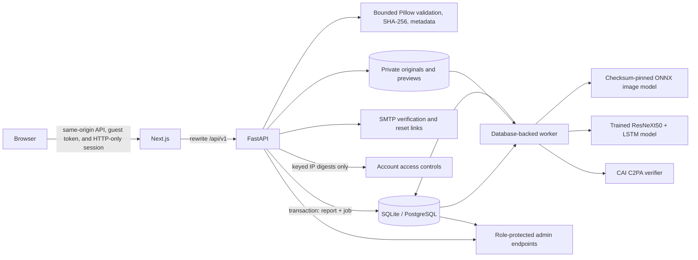

# CGS DeepFake Shield

**Inspect the image. Examine the evidence.**

CGS DeepFake Shield is an image- and video-forensics workspace with guest and registered access, private reports, local AI screening, a durable analysis worker, metadata inspection, and optional C2PA Content Credentials verification. Its results are evidence signals, not proof of authorship or that depicted events are true.

---

## Table of Contents

- [Quick Start](#quick-start)
- [Architecture](#architecture)
- [Technology Stack](#technology-stack)
- [Project Structure](#project-structure)
- [Database Models](#database-models)
- [AI Detection Models](#ai-detection-models)
  - [Image ONNX Model (Layer 1)](#image-onnx-model-layer-1)
  - [Video Temporal Model (Layer 2)](#video-temporal-model-layer-2)
  - [C2PA Content Credentials Scanner](#c2pa-content-credentials-scanner)
  - [Spectral Frequency Analysis](#spectral-frequency-analysis)
- [Authentication and Sessions](#authentication-and-sessions)
- [Access Controls and Rate Limiting](#access-controls-and-rate-limiting)
- [Durable Worker and Job Queue](#durable-worker-and-job-queue)
- [Admin Console](#admin-console)
- [Design System](#design-system)
- [Configuration Reference](#configuration-reference)
- [API and Health Endpoints](#api-and-health-endpoints)
- [Testing](#testing)
- [Security](#security)
- [Privacy and Data Handling](#privacy-and-data-handling)
- [Operations Guide](#operations-guide)
- [Docker Compose Deployment](#docker-compose-deployment)
- [Vercel Frontend Deployment](#vercel-frontend-deployment)
- [Architecture Decisions](#architecture-decisions)
- [Detector Scope and Limitations](#detector-scope-and-limitations)
- [Known Limits](#known-limits)

---

## Quick Start

From the project root in PowerShell, run one command:

```powershell
.\run.ps1
```

The launcher prepares Python and web dependencies when they change, applies database migrations, verifies or downloads the pinned 44 MB model, then starts the API, inference worker, and frontend together. Press **Ctrl+C** in that terminal to stop all three. Logs are written under `.run/logs/`.

On first run, `run.ps1` creates `.env` from `.env.example` and generates a 256-bit URL-safe `ADMIN_LOGIN_SLUG` if it is blank. Set `ADMIN_EMAILS` in `.env` to the administrator email address. After the app has started, open another PowerShell window and create the administrator through the local bootstrap command:

```powershell
Set-Location apps/api
.\.venv\Scripts\python.exe -m app.bootstrap_admin admin@example.com
```

The command prompts for the password and only grants administrator access to an allowlisted address. Public signup never grants the admin role. `run.ps1` prints the private administrator sign-in URL when it starts. The page returns not found unless its path matches the high-entropy slug in `.env`; the admin area is excluded from indexing and verifies administrator role on the server and every admin API request. The slug reduces discovery but is not a substitute for authentication or authorization.

For Docker Compose, set `ADMIN_LOGIN_SLUG` in `.env` to at least 32 URL-safe random characters before starting the services.

The first setup requires package/model downloads. If the model download is unavailable, the rest of the app still starts and reports AI screening as unavailable. It never substitutes a fake production score. C2PA validation uses the official Python SDK; if that SDK cannot load in a particular runtime, the report labels provenance verification unavailable.

### Test and Build

Backend tests:

```powershell
Set-Location apps/api
.\.venv\Scripts\python.exe -m pytest
```

Frontend checks:

```powershell
Set-Location apps/web
npm run lint
npm run typecheck
npm run build
```

Install the matching Chromium binary once, then run browser journeys:

```powershell
npx playwright install chromium
npm run test:e2e
```

Playwright starts the stack with an isolated database and test-only detector, then shuts the services down when the run completes.

---

## Architecture



### Trust Boundaries and Processing Flow

1. **Registered users** receive opaque HTTP-only sessions; only their SHA-256 token digests are stored. Passwords use Argon2id. New accounts must verify their email before analysis.
2. **Guests** without a valid account session receive a signed, opaque, HTTP-only guest cookie. The database stores the guest ID and timestamps; it does not store a browser fingerprint or guest usage quota. Proxy-derived IPs are accepted only from configured trusted CIDRs.
3. **Upload route** applies persistent request rate limits and account/IP access controls, then performs bounded content validation. Pillow validates still images; the video path checks content, decodability, dimensions, and configured duration. The report and queued inference job are inserted before the same transaction commits. There is no balance check or per-analysis charge.
4. **Guest reports** are visible through the signed guest identity and move to the account when that guest registers.
5. **Worker** claims jobs with a conditional database update and a lease. A crashed worker's expired lease can be recovered by a later worker. Retries use bounded exponential backoff; exhausted jobs are marked failed without any balance adjustment.
6. **Worker records** model output and C2PA verification independently. A detector error does not erase successful integrity/provenance observations. No remote inference service receives the media.
7. **Authorization**: every report, preview, deletion, and admin action is authorized server-side. User-owned report queries include the authenticated user ID or guest ID. Admin routes check the role on the API; hidden routes and noindex metadata are only additional controls.

---

## Technology Stack

### Runtime

| Technology | Version or Range | Purpose |
|---|---|---|
| Python | 3.11+ | FastAPI API, SQLAlchemy models, Alembic migrations, and durable worker |
| FastAPI | `>=0.115,<1` | HTTP API and dependency-based authorization |
| SQLAlchemy | `>=2.0,<3` | ORM and transactional database access |
| SQLite | Python bundled driver | Single-host local development and tests |
| PostgreSQL | supported deployment service | Production database with forced row-level security |
| Next.js | `^16.4.0` | App Router web application and same-origin API proxy |
| React / React DOM | `^19.3.0` | Client and server UI rendering |
| TypeScript | `^6.0.3` | Frontend type checking |
| Node.js | 24 LTS recommended | Next.js development, production build, and browser tests |

### Selected Production Dependencies

| Package | Constraint | Purpose |
|---|---|---|
| `argon2-cffi` | `>=23,<26` | Argon2id password hashing |
| `pydantic` | `>=2.7,<3` | Request validation and response schemas |
| `email-validator` | `>=2,<3` | Validated email addresses |
| `Pillow` | `>=10,<13` | Bounded still-image decoding, validation, metadata, and preview generation |
| `onnxruntime` | `>=1.20,<2` | Local CPU screening inference |
| `c2pa-python` | `>=0.33,<1` | Content Credentials inspection |
| `torch`, `torchvision` | `>=2.0`, `>=0.15` | Optional temporal video detector runtime |
| `opencv-python-headless` | `>=4.8,<5` | Video decoding and keyframe extraction |
| `Alembic` | `>=1.13,<2` | Versioned schema changes |
| `psycopg[binary]` | `>=3.2,<4` | PostgreSQL driver |

### Development and Verification Dependencies

| Package | Purpose |
|---|---|
| `pytest` | Backend unit and API tests |
| `httpx` / `httpx2` | FastAPI test clients and HTTP support |
| `eslint` / `typescript-eslint` | Frontend linting |
| `@playwright/test` | Isolated Chromium browser journeys |

### Infrastructure and Integrations

| Service or Component | Purpose |
|---|---|
| SMTP relay | Deliver one-time email verification and password-reset links |
| Private local storage | Store generated-key originals and report previews; never served as a static directory |
| Database-backed worker | Claim, retry, and complete queued analysis jobs |
| Local model artifact | Checksum-verified ONNX CPU image screening |
| CAI C2PA SDK | Verify credentials and retain compact provenance summaries |
| PowerShell `run.ps1` | Prepare local dependencies, apply migrations, and start API, worker, and web app |

---

## Project Structure

```
CGS DeepFake Shield/
├── .env                        # Local environment variables (git-ignored)
├── .env.example                # Template with all configurable variables
├── VERSION                     # Current platform version
├── README.md                   # ← This file (comprehensive platform documentation)
├── run.ps1                     # Root PowerShell launcher for local development
├── docker-compose.yml          # Docker Compose reference deployment
├── model_capabilities.yaml     # Optional AI model capability hints
│
├── apps/
│   ├── api/                    # Python FastAPI backend
│   │   ├── app/
│   │   │   ├── main.py             # FastAPI app, SQLAlchemy models, all API routes
│   │   │   ├── detectors.py        # ONNX image detector, provider contract, test fixture
│   │   │   ├── temporal_detector.py # ResNeXt50 + LSTM video temporal inference
│   │   │   ├── scanner.py          # C2PA Content Credentials verification
│   │   │   ├── video.py            # Video ingestion, validation, frame extraction
│   │   │   ├── worker.py           # Database-backed durable worker with leases
│   │   │   ├── download_model.py   # Model artifact downloader with SHA-256 verification
│   │   │   ├── bootstrap_admin.py  # CLI tool for creating admin accounts
│   │   │   └── migrate.py          # Alembic migration runner
│   │   ├── migrations/
│   │   │   ├── env.py              # Alembic environment configuration
│   │   │   └── versions/
│   │   │       ├── 0001_initial.py
│   │   │       ├── 0002_durable_queue_security_admin.py
│   │   │       ├── 0004_user_contact_details.py
│   │   │       ├── 0005_guest_credits_auth.py
│   │   │       ├── 0006_retire_credits.py
│   │   │       ├── 0007_repair_adopted_schema.py
│   │   │       ├── 0008_admin_console_management.py
│   │   │       └── 0009_admin_workforce_and_logs.py
│   │   ├── tests/
│   │   │   ├── conftest.py
│   │   │   ├── test_api.py
│   │   │   ├── test_scanner.py
│   │   │   ├── test_video_temporal.py
│   │   │   ├── test_credit_retirement_migration.py
│   │   │   └── test_production_startup.py
│   │   ├── storage/                # Private local originals and previews (not web-served)
│   │   ├── data/                   # SQLite database location (local dev)
│   │   └── requirements.txt       # Python dependencies
│   │
│   └── web/                    # Next.js App Router frontend
│       ├── src/
│       │   ├── app/
│       │   │   ├── layout.tsx          # Root layout
│       │   │   ├── page.tsx            # Home / landing page
│       │   │   ├── loading.tsx         # Root shimmer skeleton
│       │   │   ├── not-found.tsx       # Global 404 page
│       │   │   ├── globals.css         # Global styles
│       │   │   ├── theme.css           # Design system tokens and theme definitions
│       │   │   ├── auth.css            # Authentication page styles
│       │   │   ├── account-access.css  # Account access restriction styles
│       │   │   │
│       │   │   ├── app/               # Authenticated workspace
│       │   │   │   ├── page.tsx           # Analysis workspace
│       │   │   │   ├── analyze/           # Upload / analysis flow
│       │   │   │   ├── analyses/[id]/     # Individual report view
│       │   │   │   ├── history/           # Report history
│       │   │   │   └── settings/          # Account settings
│       │   │   │
│       │   │   ├── admin/             # Administrator console
│       │   │   │   ├── admin-content.tsx   # Full admin dashboard component
│       │   │   │   ├── login/             # Admin sign-in
│       │   │   │   └── [gate]/            # Slug-gated admin entry
│       │   │   │
│       │   │   ├── sign-in/           # User sign-in
│       │   │   ├── sign-up/           # User registration
│       │   │   ├── login/             # Alias login route
│       │   │   ├── register/          # Alias registration route
│       │   │   ├── forgot-password/   # Password reset request
│       │   │   ├── reset-password/    # Password reset completion
│       │   │   ├── verify-email/      # Email verification
│       │   │   ├── admin-invite/      # Admin invitation acceptance
│       │   │   │
│       │   │   ├── about/             # About page
│       │   │   ├── contact/           # Contact page
│       │   │   ├── how-it-works/      # How it works / pricing page
│       │   │   ├── solutions/         # Solutions with testimonials
│       │   │   ├── technology/        # Technology overview
│       │   │   ├── privacy/           # Privacy policy
│       │   │   └── terms/             # Terms of service
│       │   │
│       │   ├── components/        # Shared React components
│       │   │   ├── auth-guard.tsx     # Route protection
│       │   │   ├── auth-form.tsx      # Authentication forms
│       │   │   └── upload-form.tsx    # File upload component
│       │   │
│       │   ├── lib/
│       │   │   └── api.ts             # Shared API contracts
│       │   │
│       │   └── proxy.ts           # API proxy rewrite configuration
│       │
│       ├── e2e/                   # Playwright browser test suites
│       └── public/                # Static assets
│
├── models/                     # Downloaded AI model artifacts
│   └── temporal_cache/         # Cached video model checkpoint
│
├── data/                       # Local data directory
├── scripts/                    # Utility scripts
├── test-storage/               # Test storage directory
│
├── .gsd/                       # GSD methodology project state
│   ├── SPEC.md                 # Finalized requirements specification
│   ├── ROADMAP.md              # Phase-based implementation roadmap
│   ├── STATE.md                # Session memory and state snapshots
│   └── templates/              # Document templates
│
├── .agent/workflows/           # GSD slash command workflows
├── .agents/                    # GSD subagent and skill definitions
└── .gemini/                    # Gemini-specific configuration
```

---

## Database Models

All models are defined in `apps/api/app/main.py` using SQLAlchemy ORM with Alembic-managed migrations.

### Core Models

| Model | Table | Purpose |
|---|---|---|
| `User` | `users` | Normalized email identity, display name, username, phone, Argon2 hash, verification/reset token digests and expiries, role, enabled state, signup method, signup IP, creation time |
| `UserSession` | `sessions` | Token digest, user ID, expiry, revocation time. Opaque HTTP-only session cookies |
| `GuestSession` | `guest_sessions` | Signed-cookie identity, linked user, creation/last-seen timestamps. No fingerprint |
| `Analysis` | `analyses` | Either a user owner or guest owner, idempotency key, file facts/hash, private object keys, status, technical metadata, detector output, C2PA summary, timestamps |
| `InferenceJob` | `inference_jobs` | Durable processing state, attempt count, lease, retry time, worker ID, safe error code |

### Security and Access Models

| Model | Table | Purpose |
|---|---|---|
| `RateLimitBucket` | `rate_limit_buckets` | HMAC key digest, request count, reset epoch |
| `IpAccountLink` | `ip_account_links` | Hashed-IP account enforcement with first/last seen times |
| `IpEnforcementGuard` | `ip_enforcement_guards` | Per-hash write lock for simultaneous account/guest checks |
| `IpBlock` | `ip_blocks` | IP restriction records with status, reason, linked accounts, raised limits |
| `IpWhitelist` | `ip_whitelist` | Administrator-managed IP allowlist |
| `UnblockRequest` | `unblock_requests` | User-submitted unblock requests with name, email, reason, status |
| `AccessAuditEvent` | `access_audit_events` | Privacy-preserving access audit trail |

### Administration Models

| Model | Table | Purpose |
|---|---|---|
| `AuditEvent` | `audit_events` | Administrator actor, action, subject, non-sensitive detail JSON, timestamp |
| `UserActivityEvent` | `user_activity_events` | User activity logs for admin review |
| `AdminInvitation` | `admin_invitations` | One-time expiring administrator invitations |
| `WorkerHeartbeat` | `worker_heartbeats` | Worker ID, process ID, last-seen time for admin health state |
| `ContactInquiry` | `contact_inquiries` | Persistent contact form submissions with status and admin notes |
| `SystemSetting` | `system_settings` | Server-enforced platform settings (registration, inspections) |

### Migration History

| Revision | Purpose |
|---|---|
| `0001_initial` | Base schema: users, sessions, analyses |
| `0002_durable_queue_security_admin` | Inference jobs, rate limits, IP controls, audit events |
| `0004_user_contact_details` | User phone and contact fields |
| `0005_guest_credits_auth` | Guest sessions and authentication enhancements |
| `0006_retire_credits` | Removes live credit tables; archives ledger outside ORM mappings |
| `0007_repair_adopted_schema` | Schema repairs and alignment |
| `0008_admin_console_management` | Contact inbox, platform settings, admin console tables |
| `0009_admin_workforce_and_logs` | Admin invitations, signup attribution, user activity logs |

Migrations are managed with Alembic. The local launcher applies them before starting services. PostgreSQL deployments use forced row-level security with no runtime policy to protect archived data.

---

## AI Detection Models

### Image ONNX Model (Layer 1)

The primary image detector uses a checksum-pinned ONNX model for whole-image AI-generation screening.

| Property | Value |
|---|---|
| Model ID | `Thermostatic/community-forensics-low-quality-detector-2026-08` |
| Artifact | `community_forensics_low_quality_fp16.onnx` |
| Artifact Size | 43,778,110 bytes |
| SHA-256 | `88ca8e90e5ab33e6e13887124614e14ba96d7c8cc9ecb21505b63cdc6549ff17` |
| License | MIT |
| Runtime | ONNX Runtime CPU provider |
| Lineage | Independently fine-tuned release based on `OwensLab/commfor-model-384` |

#### Preprocessing Pipeline

1. Apply EXIF orientation, convert to RGB, resize short edge to 440 pixels, center-crop to 384 × 384.
2. Convert to float32 in `[0,1]`, normalize channels with ImageNet mean `[0.485, 0.456, 0.406]` and standard deviation `[0.229, 0.224, 0.225]`.
3. Run the single-image ONNX graph on CPU to obtain one raw logit `x`.
4. Compute the published calibration mapping: `sigmoid(0.6352260751077209 × x − 0.2643220522904507)`.
5. Apply the published screening threshold `0.65`. Scores at or above indicate an "AI-generated signal"; lower scores report "No strong AI-generated signal" with an inconclusive overall result.

The output is stored as a **calibrated screening score**, not a population probability. Its calibrator was fit on a class-balanced development set.

#### Evaluation (Author-Reported)

| Evaluation View | Balanced Accuracy | Fake Recall | Real Specificity |
|---|---:|---:|---:|
| Clean | 0.9530 | 0.9549 | 0.9511 |
| Web-laundered | 0.9359 | 0.9020 | 0.9697 |
| Hard-degraded | 0.8982 | 0.8543 | 0.9420 |
| Low-quality aggregate | 0.7584 | 0.5612 | — |

These are the author's results; CGS DeepFake Shield has not independently reproduced them.

#### Known Model Weaknesses

- A composite with 5% synthetic foreground reached balanced accuracy 0.5080 and fake recall 0.0492. The model is whole-image only and can miss a small manipulated region.
- The per-image worst-of-attacks fake recall is reported as 0.0026; extreme laundering can defeat the classifier.
- At 96-pixel JPEG quality 20, reported low-quality fake recall is 0.3914.
- External physical recapture, platform laundering, and generative laundering families were absent from coverage.
- ONNX FP16 and PyTorch bfloat16 did not produce identical logits.
- No claim is made that the screening score is calibrated for any specific user population.

#### Failure Behavior

- Missing dependency or model file → `not_configured` status, null score.
- Checksum/size validation or inference fails → safe failure status, no score. Metadata and C2PA scanning can still complete.
- The worker persists the model identity, score semantics, threshold policy, and inference duration with the report.
- E2E tests use a deterministic fixture explicitly marked `test_only`; provider configuration rejects it outside `APP_ENV=test` or `e2e`.

### Video Temporal Model (Layer 2)

The video detector uses a trained ResNeXt50 + LSTM architecture for temporal deepfake analysis.

| Property | Value |
|---|---|
| Model ID | `Naman712/Deep-fake-detection` |
| Architecture | ResNeXt50 backbone + LSTM temporal head |
| Checkpoint | `model_87_acc_20_frames_final_data.pt` |
| Input Size | 112 × 112 pixels per frame |
| Sequence Length | 20 frames |
| Threshold | 0.60 |
| Runtime | PyTorch CPU |

#### Key Properties

- The model never substitutes randomly initialized weights. A video score is emitted only after checkpoint validation and a successful forward pass.
- The checkpoint is gated by its publisher on Hugging Face and requires approved access plus a read token (`HF_TOKEN`).
- Without a validated checkpoint, Layer 2 reports unavailable and emits no temporal score.
- Frame preprocessing uses ImageNet normalization (same mean/std as the image model).

### C2PA Content Credentials Scanner

The C2PA scanner (`apps/api/app/scanner.py`) uses the official CAI `c2pa-python` SDK to read and validate embedded Content Credentials.

| Status | Meaning |
|---|---|
| `trusted` | Valid manifest with trusted signer |
| `valid_untrusted` | Structurally valid but signer not in trust list |
| `invalid` | Manifest present but validation failed |
| `not_present` | No C2PA manifest found in the file |
| `unavailable` | C2PA SDK not installed in runtime |
| `error` | SDK could not read/validate the asset |

The report stores validation state and selected assertion/source-type summaries, not the complete raw manifest. A valid credential does not establish that an image depicts real events.

### Spectral Frequency Analysis

An additional forensic signal computed via 2D FFT magnitude spectrum to identify high-frequency upsampling artifacts typical of AI-generated images. Outputs include:

- `high_freq_power_db` — Mean high-frequency spectral power
- `low_freq_power_db` — Mean low-frequency spectral power
- `spectral_drift_ratio` — High/low frequency ratio
- `frequency_dispersion` — Standard deviation of the magnitude spectrum

---

## Authentication and Sessions

### User Authentication

- **Registration**: normalized email, display name, username (optional), phone (optional), Argon2id password hashing with a 15-character passphrase minimum.
- **Email identity**: Gmail-alias-normalized uniqueness enforcement. Disposable email domains are rejected.
- **Email verification**: required before analysis. One-time verification links with configurable TTL (`EMAIL_VERIFICATION_TTL_HOURS`).
- **Password reset**: one-time links with configurable TTL (`PASSWORD_RESET_TTL_HOURS`).
- **Sessions**: opaque random cookies, SHA-256 token digests at rest, `HttpOnly`, `SameSite=Lax`, configurable `Secure`, server-side expiry and revocation.

### Guest Identity

- Signed, opaque, HttpOnly cookie with a random ID.
- No browser fingerprint, no device tracking, no guest usage quota.
- Guest report history carries over to a newly registered account.

### Admin Authentication

- `ADMIN_EMAILS` allowlist controls who can be granted admin access.
- Admin creation via the CLI `bootstrap_admin` command only (prompts for password).
- Public signup always creates a standard user, never admin.
- Admin login at `/admin/login`; hidden from public navigation, marked `noindex`.
- Every admin API request verifies the database role server-side.
- Admin invitations use one-time expiring tokens.

---

## Access Controls and Rate Limiting

### Rate Limits

All rate limits use fixed-window counters stored in `rate_limit_buckets`. SQLite/PostgreSQL upserts increment counters atomically across API processes. Database keys are HMAC digests, not raw IP addresses or session tokens.

| Limit | Default | Scope |
|---|---|---|
| Auth (signup/login) | 12 / 15 minutes | Per direct client IP |
| Auth identity | 12 / 15 minutes | Per normalized email |
| Analysis (owner) | 12 / hour | Per authenticated user or guest owner |
| Analysis (IP) | 30 / hour | Per client IP |
| Upload fallback | 30 / hour | Per client IP |
| Unblock requests | 3 / day | Per client IP |

### IP-Based Account Controls

- `MAX_ACCOUNTS_PER_IP` (default: 3) limits distinct accounts per hashed client IP.
- `IP_ACCOUNT_WINDOW_DAYS=0` keeps links for lifetime counting; positive values use a rolling window.
- **Soft mode** (`IP_BLOCK_MODE=soft`): blocks new accounts and guest analysis; preserves access for already-linked accounts.
- **Hard mode** (`IP_BLOCK_MODE=hard`): denies all sign-in and analysis from the blocked IP until admin resolution.
- Only keyed IP hashes appear in application records or admin output.
- Admins can inspect blocks, manage unblock requests, whitelist IPs, and raise per-IP limits.

### Proxy Trust

The app uses the direct network peer address by default. `TRUSTED_PROXY_CIDRS` controls which reverse proxies may supply a client IP through `X-Forwarded-For`. All untrusted forwarded addresses are ignored.

---

## Durable Worker and Job Queue

The analysis worker (`apps/api/app/worker.py`) implements a database-backed durable job queue.

### How It Works

1. A new upload creates both the `Analysis` row and an `InferenceJob` row in **one database transaction**.
2. The worker **polls** for eligible jobs and claims them with a **conditional `UPDATE ... WHERE status/lease still eligible`** — ensuring only one worker processes a given job.
3. Each claim sets an **expiring lease** (`INFERENCE_LEASE_SECONDS`, default: 1800s / 30 minutes).
4. On crash, the expired lease allows a subsequent worker to reclaim the job.
5. **Bounded exponential backoff** retries up to `INFERENCE_MAX_ATTEMPTS` (default: 3).
6. Exhausted jobs are marked `failed` with a safe error code.

### Job States

| Status | Meaning |
|---|---|
| `queued` | Awaiting processing |
| `processing` | Claimed by a worker with active lease |
| `completed` | Successfully processed |
| `failed` | Exhausted retries or permanent failure |

### Worker Features

- **Worker heartbeats** — recorded in `worker_heartbeats` for admin health monitoring.
- **Layer 1 image inference** — ONNX model for still images.
- **Layer 2 temporal inference** — ResNeXt50 + LSTM for video frames.
- **C2PA scanning** — Content Credentials verification.
- **Independent results** — a detector error does not erase successful integrity/provenance observations.
- **No remote inference** — all media processing is local; no external service receives the media.

### Retention Cleanup

When `UPLOAD_RETENTION_DAYS` is set to a positive value, the worker periodically deletes completed or failed reports and their private files after that many days. Default `0` disables automatic cleanup.

---

## Admin Console

The admin console is a restricted dashboard accessible only to authenticated administrators.

### Dashboard Sections

1. **Overview** — Actual account counts, detector/worker health, queue status.
2. **User Management** — Search, view signup method/IP, contact fields, ban/unban, confirmed account deletion. Separate from the inspection ledger.
3. **Inspection Ledger** — Searchable report summaries and account details. Media bytes remain private and owner-scoped.
4. **Queue & Jobs** — Queue inspection, retry controls, worker health monitoring, last error codes.
5. **Contact Inbox** — Persistent contact form submissions. Admins can view, search, assign status, and add private notes.
6. **Administrator Management** — One-time expiring invitations, admin role changes, session revocation with exact typed confirmation. A protected bootstrap administrator cannot be demoted.
7. **Activity Logs** — Searchable user activity logs and administrator audit logs. Separately purgeable. Clearing the admin log retains a purge record.
8. **Security & Traffic** — Pending access requests, active network restrictions, allowlist management. Danger-zone session revocation requires exact typed confirmation.
9. **Platform Settings** — Registration and inspection toggles. Server-enforced with JSON boolean values. Requires exact confirmation phrase before writes.

### Admin Security

- No public navigation link; marked `noindex` in metadata and response headers.
- Private no-store caching on all admin responses.
- Server-rendered page and every admin API request verify the account role.
- Administrators cannot disable/demote their own account through the console.
- Admin account changes, deletions, and analysis retries are written to `audit_events`.
- Disabling a user revokes their active sessions.

---

## Design System

### Brand

The interface uses a dark-first, evidence-led visual style. Deep navy establishes the workspace; electric cyan identifies the brand; signal blue marks primary actions. The shield mark combines a geometric outline with image-scan corner brackets.

### Typography

- **Inter** — Interface and report text. Self-hosted through Fontsource, weights 400–900.
- **IBM Plex Mono** — Hashes, report IDs, timestamps, technical metadata, model states. Self-hosted, weights 400–700.
- Both families use system fallbacks. No third-party font requests.

### Color Tokens

| Role | Dark Theme | Light Theme |
|---|---|---|
| Page background | `#0B1020` | `#F8FAFC` |
| Surface | `#111827` | `#FFFFFF` |
| Raised surface | `#1E293B` | `#F1F5F9` |
| Primary text | `#E5E7EB` | `#0F172A` |
| Secondary text | `#94A3B8` | `#475569` |
| Borders | `#263248` | `#CBD5E1` |
| Brand accent | `#22D3EE` | `#0891B2` |
| Primary action | `#3B82F6` | `#2563EB` |
| AI-specific information | `#818CF8` | `#6366F1` |
| Successful processing | `#34D399` | `#047857` |
| Uncertain findings | `#FBBF24` | `#92400E` |
| Errors | `#F87171` | `#B91C1C` |

### Theme Behavior

- Dark mode is the default.
- One shared `ThemeToggle` control is used across workspace, user auth, admin auth, and invitation acceptance.
- Preference stored in local storage, synchronized across tabs.
- Theme switches without a full-screen ripple; transitions suppressed for 80ms during switch.
- Reduced-motion preferences respected.

### Interface Rules

- Use status text as well as color. Amber marks inconclusive evidence; green does not imply authenticity.
- Use the shared raised, inset, and embossed tokens for surfaces and controls.
- Use 10–12 px button radii, 12 px card radii, subtle borders, restrained shadows.
- Responsive layouts collapse to a single column on smaller screens.
- Keep focus indicators visible, use keyboard-accessible controls.

### UI Enhancements

- Consent banner with browser-local accept/reject preference.
- Themed global 404 page and root shimmer skeleton.
- Animated caret input on text fields.
- Center-origin circle theme transitions.
- Animated utility tooltips and edge-fade scroll areas.
- Separate public navigation with Home, Solutions, Technology, Pricing, About, and Contact routes.
- Categorized full-width Explore mega menu.
- Three pricing tiers (Pro highlighted) labeled as illustrative.
- Testimonial carousel and split Contact page.
- Responsive split-screen branded report panel on sign-in/sign-up.
- A4-friendly print-to-PDF result reports with branded headers.

---

## Configuration Reference

All settings are configured via `.env`. Copy `.env.example` to `.env` for local settings.

### Core Settings

| Variable | Default | Purpose |
|---|---|---|
| `APP_ENV` | `development` | Runtime mode. Test detector only works in `test` and `e2e` |
| `APP_SECRET_KEY` | example placeholder | Secret HMAC pepper for persistent rate-limit keys. Set a random secret before deployment |
| `DATABASE_URL` | SQLite in `apps/api/data/` | Use PostgreSQL for multi-host deployment |
| `STORAGE_DIR` | `./storage` | Private local originals and normalized previews |

### Admin and Email

| Variable | Default | Purpose |
|---|---|---|
| `ADMIN_EMAILS` | empty | Comma-separated addresses eligible for the admin role |
| `ADMIN_LOGIN_SLUG` | auto-generated | High-entropy URL path for admin sign-in page |
| `SMTP_HOST` | empty | Email delivery host (required for production) |
| `SMTP_PORT` | `587` | SMTP port |
| `SMTP_FROM_EMAIL` | empty | Sender address (required for production) |
| `SMTP_USERNAME` | empty | SMTP authentication username |
| `SMTP_PASSWORD` | empty | SMTP authentication password |
| `SMTP_STARTTLS` | `true` | SMTP transport security |
| `PUBLIC_APP_ORIGIN` | `http://localhost:3000` | Base URL used in one-time email links |
| `SUPPORT_CONTACT_EMAIL` | empty | Required in production; displayed on IP restriction notices |

### AI Detector

| Variable | Default | Purpose |
|---|---|---|
| `AI_DETECTOR_PROVIDER` | `local` | `local` runs the ONNX model; `disabled` disables it |
| `AI_MODEL_PATH` | `./models/community_forensics_low_quality_fp16.onnx` | Local model path |
| `HF_TOKEN` | empty | Hugging Face token for gated video model checkpoint |
| `TEMPORAL_MODEL_CACHE` | `./models/temporal_cache` | Video model cache directory |
| `INFERENCE_CPU_THREADS` | `2` | CPU threads for inference |

### Upload Limits

| Variable | Default | Purpose |
|---|---|---|
| `MAX_UPLOAD_BYTES` | 10 MiB | Request file limit for images |
| `MAX_VIDEO_BYTES` | 50 MiB | Video upload cap |
| `MAX_VIDEO_SECONDS` | `300` | Maximum accepted video duration |
| `MAX_IMAGE_PIXELS` | 40 million | Decoded-pixel safety limit |

### Rate Limits

| Variable | Default | Purpose |
|---|---|---|
| `RATE_LIMIT_AUTH_LIMIT` | 12 / 15 minutes | Per-client signup and login request limit |
| `RATE_LIMIT_AUTH_IDENTITY_LIMIT` | 12 / 15 minutes | Per-email login and per-email/per-username signup limit |
| `RATE_LIMIT_UPLOAD_LIMIT` | 30 / hour | Fallback for the per-IP analysis rate limit |
| `RATE_LIMIT_ANALYSIS_OWNER_LIMIT` | 12 / hour | Per authenticated user or guest owner |
| `RATE_LIMIT_ANALYSIS_IP_LIMIT` | 30 / hour | Per client IP |
| `RATE_LIMIT_ANALYSIS_WINDOW_SECONDS` | `3600` | Shared analysis rate-limit window |
| `RATE_LIMIT_SUPPORT_LIMIT` | 3 / day | Unblock requests per client IP |

### Session and Guest

| Variable | Default | Purpose |
|---|---|---|
| `SESSION_TTL_HOURS` | `168` | User session lifetime |
| `SESSION_COOKIE_SECURE` | `false` | Set `true` behind HTTPS |
| `GUEST_COOKIE_NAME` | `cgs_guest` | Signed, HttpOnly guest identity cookie |
| `GUEST_COOKIE_TTL_DAYS` | `365` | Guest identity lifetime |

### IP Controls

| Variable | Default | Purpose |
|---|---|---|
| `MAX_ACCOUNTS_PER_IP` | `3` | Distinct accounts allowed from a hashed client IP |
| `IP_ACCOUNT_WINDOW_DAYS` | `0` | `0` = lifetime counting; positive = rolling window |
| `IP_BLOCK_MODE` | `soft` | `soft` preserves access for linked accounts; `hard` denies all access |
| `TRUSTED_PROXY_CIDRS` | empty | Only these reverse proxies may supply a client IP |

### Email Verification and Recovery

| Variable | Default | Purpose |
|---|---|---|
| `EMAIL_VERIFICATION_TTL_HOURS` | `24` | Email verification link lifetime |
| `PASSWORD_RESET_TTL_HOURS` | `1` | Password reset link lifetime |
| `DISPOSABLE_EMAIL_DOMAINS` | built-in list | Additions/replacements for disposable email rejection |

### Retention and Origins

| Variable | Default | Purpose |
|---|---|---|
| `UPLOAD_RETENTION_DAYS` | `0` | `0` retains until user deletion; positive = auto-cleanup after N days |
| `APP_ORIGINS` | localhost origins | Allowed browser origins for state-changing API requests |

---

## API and Health Endpoints

With the app running, the API is at `http://127.0.0.1:8000`.

| Endpoint | Purpose |
|---|---|
| `/docs` | Local development API documentation (disabled in production) |
| `/health/live` | Process liveness check |
| `/health/ready` | Database connectivity and writable storage check |
| `/api/v1/config` | Public configuration and detector health status |
| `/api/v1/*` | All authenticated API endpoints |

The authenticated API is under `/api/v1`. Private-by-default routing requires the verified server session on every operation except public configuration, signup, and login. A startup route check fails closed if a new private API route is added without the auth dependency.

---

## Testing

### Local Checks

```powershell
# Backend
Push-Location apps\api
.\.venv\Scripts\python.exe -m pytest
Pop-Location

# Frontend
Push-Location apps\web
npm run lint
npm run typecheck
npm run build
npx playwright install chromium
npm run test:e2e
Pop-Location
```

### What Tests Cover

**Backend tests** cover:
- Authentication and sessions
- Image validation and ownership
- Persistent request rate limits
- Queue recovery and retries
- Admin actions and audit events
- Detector configuration guards
- C2PA SDK integration
- Credit retirement migration verification

**Playwright browser tests** cover:
- Signup, upload, durable processing, report evidence, delete
- Allowlisted admin login and console access
- Rejection of non-admin users from admin routes

**Frontend checks**: ESLint, TypeScript strict mode, and Next.js production build.

### What Tests Do NOT Cover

- Detector accuracy (model-specific smoke inference only confirms the graph loads).
- Docker Compose startup when Docker is unavailable.
- Every device, browser, resolution, or dataset.
- Live PostgreSQL RLS policy enforcement (reviewed in migration source).

### E2E Mode

The Playwright config starts the root launcher in isolated E2E mode with:
- A per-run SQLite database
- A per-run storage folder
- An allowlisted test admin
- A deterministic test-only detector that cannot be selected outside `APP_ENV=test` or `e2e`

---

## Security

### Implemented Controls

- **File validation**: JPEG/PNG/WebP allowlist; extension, decoded bytes, and declared content type must agree. Request and decoded-pixel limits, Pillow verification, safe decoding, normalized previews.
- **Video validation**: Content type, decodability, dimension, and duration checks.
- **Storage**: Generated keys allowlisted and resolved inside private local storage outside web root. Owner-only permissions on POSIX hosts. Owner-checked routes with private no-store caching and `nosniff`.
- **Password security**: Argon2id hashing, 15-character minimum passphrase, opaque random session cookies, SHA-256 session-token digests at rest, `HttpOnly`, `SameSite=Lax`, configurable `Secure`, session expiry, server-side revocation.
- **API security**: Private-by-default `/api/v1` routing with startup route check. Admin APIs check database role. ORM parameterized queries. Request models reject unexpected fields and strip unsafe control characters.
- **CORS**: Exact-origin credentialed CORS, same-origin mutation checks, browser Fetch Metadata checks. Production requires exact `APP_ORIGINS`.
- **Rate limiting**: Persistent fixed-window limits for signup, login, upload, and admin operations. HMAC-digested keys.
- **Row-level security (PostgreSQL)**: `ENABLE` and `FORCE ROW LEVEL SECURITY` for users, sessions, analyses, inference jobs, and audit events. Non-owner runtime role with no `BYPASSRLS`.
- **Model security**: Fixed size and SHA-256 verification. Inference-only ONNX — no remote Python code or pickle checkpoint loading.
- **C2PA**: Limited summary returned; raw manifest never included in user reports.
- **Admin security**: No public link, `noindex`, private no-store caching, server-side role verification on every request. Audit trail for all admin actions.
- **Headers**: Security headers on API and frontend responses. CSP, clickjacking protection, referrer policy, permissions policy, cross-origin headers, production HSTS.
- **Logging**: Omits image bytes, passwords, session tokens, raw EXIF, and raw model tensors.

### Pre-Deployment Checklist

1. Replace `APP_SECRET_KEY` with a generated secret; protect `.env`.
2. Set `SESSION_COOKIE_SECURE=true` behind HTTPS.
3. Use managed PostgreSQL with separate `POSTGRES_PASSWORD`, `APP_DB_PASSWORD`, and `MIGRATOR_DB_PASSWORD`.
4. Set exact `APP_ORIGINS` and TLS at the reverse proxy.
5. Configure edge rate limits at the reverse proxy.
6. Review worker concurrency and lease duration for the model host.
7. Restrict `ADMIN_EMAILS`; never assign a default public admin credential.
8. Review C2PA SDK trust configuration for deployment.
9. Obtain legal/privacy review before launch.
10. Decide email verification, password recovery, retention, deletion guarantees, incident response, and dependency update procedures.

### Threat Model

Treat uploaded bytes, metadata, file names, requests, credentials, and browser inputs as untrusted. File decode remains an attack surface even with size limits. The model is a fallible screening signal, can be evaded, and may false-positive on natural images or miss generated content.

---

## Privacy and Data Handling

> **Note:** This is starter product information, not legal advice. Review and adapt before public launch.

### Data Processed

- **Accounts**: normalized email, email-identity digests, username, display name, optional phone, Argon2 hash, role, verification state, creation timestamp. Tokens stored as digests with expiry times.
- **Sessions**: opaque random cookies; digest, expiry, revocation time stored.
- **Guests**: signed HttpOnly cookie with random ID. No fingerprints, no guest-use counts.
- **Signup IP**: stored with new accounts for admin attribution review; removed when account is deleted.
- **Uploads**: original and normalized preview in private storage until user deletion or retention cleanup.
- **Reports**: generated object keys, safe filename, format, dimensions/duration, byte count, SHA-256, selected EXIF field names, detector output, C2PA summary, timestamps.
- **Rate limits**: HMAC-digested client/session keys, counts, reset times.
- **Audit events**: actor/subject IDs, action name, limited details, timestamp. No passwords, tokens, image bytes, or raw manifests.
- **Retired credit data**: migration `0006_retire_credits` removed point balances; legacy tables renamed and blocked from runtime access via forced RLS on PostgreSQL.

### Image/Video Processing

- All analysis runs in the local inference worker; no hosted inference provider is configured.
- Video checkpoint downloaded from Hugging Face only by the worker when authorized.
- C2PA scanner stores validation state and selected summaries, not the complete manifest.
- Metadata inspection records field names and presence; no GPS coordinates or raw EXIF values published.

### Retention and Deletion

- Default `UPLOAD_RETENTION_DAYS=0`: reports and media remain until user deletes report or account.
- Positive setting: worker removes completed/failed reports and files after configured days.
- Account/report deletion removes associated local files and database rows through foreign-key cascades.
- Deployment backups may retain copies according to operator's backup lifecycle.

### User Choices

- No opt-in for model training; uploaded media is not used to train the detector.
- Email verification and recovery links via configured SMTP relay. Local dev without SMTP writes links to API log.
- Operators must disclose hosting region, proxies, database, storage, email, monitoring, backup retention, and any added providers.

---

## Operations Guide

### Local Windows Development

```powershell
.\run.ps1
```

The launcher:
1. Creates `.env` if missing.
2. Creates/updates `apps/api/.venv`.
3. Copies the frontend into a lockfile-specific directory under `.run`.
4. Uses `.run/npm-cache` and keeps `npm ci` away from `apps/web/node_modules`.
5. Warns on end-of-life Node 20; requires Node 24 LTS.
6. Prefers API port 8000 and web port 3000; selects the next available if occupied.
7. Attempts the detector artifact download.
8. Applies database migrations.
9. Starts API, worker, and frontend.

Service output is recorded in `.run/logs/`. Press Ctrl+C to stop.

### Admin Setup

Set `ADMIN_EMAILS` in `.env`. After first launch:

```powershell
Set-Location apps/api
.\.venv\Scripts\python.exe -m app.bootstrap_admin admin@example.com
```

### Model Download

First launch downloads a 43,778,110-byte model artifact. The downloader verifies the published SHA-256. If unavailable, API/web still start; AI screening reports as unavailable.

### Email Verification

Local development writes one-time email links to the API log when SMTP is not configured. Production requires `SMTP_HOST`, `SMTP_FROM_EMAIL`, and `SUPPORT_CONTACT_EMAIL`.

### Database and Queue

- Apply migrations: `.\.venv\Scripts\python.exe -m app.migrate` (or use the root launcher).
- Local dev uses SQLite. PostgreSQL for multi-process deployment.
- Workers create heartbeats for admin health monitoring.
- `/health/live` checks liveness. `/health/ready` checks database and storage.

### Retention Cleanup

Set `UPLOAD_RETENTION_DAYS` to a positive number for automatic cleanup. Default `0` disables it. Backup deletion is managed by deployment operations.

---

## Docker Compose Deployment

Docker Compose describes a PostgreSQL deployment path. Services:

| Service | Purpose |
|---|---|
| `db` | PostgreSQL 16 Alpine with custom init scripts |
| `api` | FastAPI application server |
| `worker` | Background inference worker (downloads model on start) |
| `web` | Next.js frontend (port 3000) |

### Key Configuration

- Set independent random values for `POSTGRES_PASSWORD`, `APP_DB_PASSWORD`, and `MIGRATOR_DB_PASSWORD`.
- Set `SESSION_COOKIE_SECURE=true` and exact HTTPS origins in `APP_ORIGINS`.
- Set `ADMIN_LOGIN_SLUG` to at least 32 URL-safe random characters.
- The init script creates a migration role (schema owner) and a non-owner runtime role.
- `private_storage` volume is private local storage, not an internet-facing bucket.

### Production Deployment Checklist

1. Set independent database passwords, secure cookies, exact HTTPS browser origins.
2. PostgreSQL init creates migration and runtime roles with forced RLS.
3. On existing volumes, manually create restricted roles and grant table access.
4. Run Alembic migrations as a deployment step.
5. Run API and worker as separate non-root processes with adequate CPU/RAM.
6. Put the API behind TLS and a reverse proxy with origin, size, timeout, and rate limits.
7. Set `TRUSTED_PROXY_CIDRS` only to proxy networks you control.
8. Use private object storage, secure cookies, secret manager, restricted DB credentials.
9. Monitor errors, rate limits, queue depth, leases, retries, failures, detector latency, storage, and DB capacity.
10. Test backups, restore, failed-job recovery, and account/report deletion.
11. Review legal terms, privacy/retention, model licenses, C2PA trust, and incident response.

> Docker Compose remains a reference path and has not been verified in this environment. The root PowerShell launcher is the verified local development workflow.

---

## Vercel Frontend Deployment

Deploy `apps/web` as the Vercel project root.

### Configuration

| Setting | Value |
|---|---|
| Root Directory | `apps/web` |
| Node.js | 24.x (pinned in package.json) |
| `NEXT_API_ORIGIN` | HTTPS origin of the separately deployed FastAPI API |
| Framework Preset | Next.js (default Vercel settings) |

### What Vercel Hosts

- The Next.js frontend and same-origin API proxy.
- The Next.js rewrite keeps browser API requests same-origin while forwarding to the backend.

### What Vercel Does NOT Host

- FastAPI API server
- Durable inference worker
- PostgreSQL database
- Model weights / artifacts
- Private media storage

### Required API Configuration

- Set `APP_ORIGINS` to the exact Vercel site origin.
- Set `PUBLIC_APP_ORIGIN` to the same Vercel origin.
- Set `SESSION_COOKIE_SECURE=true`.
- Configure independent secrets, SMTP, support contact, and trusted proxy CIDRs.
- Do NOT expose `HF_TOKEN` as a `NEXT_PUBLIC_*` variable.

### Deployment Steps

1. Deploy FastAPI API, worker, PostgreSQL, and private storage on services supporting long-running processes.
2. Run `python -m app.migrate` from `apps/api` as the migration role.
3. Configure `NEXT_API_ORIGIN` as the API's HTTPS origin in Vercel.
4. Deploy the Vercel project.
5. Verify API/worker readiness and both model statuses after deployment.

---

## Architecture Decisions

### Next.js + FastAPI Monorepo (2026-10-14)

Keep the existing App Router/TypeScript frontend and FastAPI/Pydantic/SQLAlchemy API. The stack supports local Python inference without replacing the working UI or authentication flow.

### SQLite Locally, PostgreSQL in Deployment (2026-10-14)

Use SQLite for a no-Docker local setup. PostgreSQL through SQLAlchemy/Alembic for multi-host deployment. The one-command launcher must not require Docker.

### Inference-Only Model with Public Caveats (2026-10-14)

Use the Thermostatic community forensics model for real local screening. ONNX export avoids loading model-repository Python or pickle checkpoints. The app pins the artifact by fixed size and SHA-256. Evaluation findings and limits are documented; output is labeled a calibrated screening score rather than a general-population probability.

### Separate Model and Provenance Tasks (2026-10-14)

The ONNX classifier screens whole images for AI-generation signals. C2PA validation and metadata are separate report sections. Missing metadata/C2PA data is not interpreted as proof of fakery; lower AI scores are not proof of authenticity.

### Database-Backed Durable Work Queue (2026-10-14)

Store inference jobs in SQL alongside each analysis in one transaction. Conditional row claims and expiring leases with bounded retries. Supports SQLite and PostgreSQL without requiring Redis/Docker.

### Persistent Database Rate Limits (2026-10-14)

Atomic fixed-window upserts in SQLite/PostgreSQL. HMAC-digest keys before storage. Direct peer address because forwarding headers are untrusted by default.

### Private Local Storage and Browser Print Reports (2026-10-14)

Store originals/previews under generated private keys outside the web root. Authorize each preview request. Use the browser's print-to-PDF flow; no server-generated PDF queue.

### Hidden Route with Explicit Admin Authorization (2026-10-14)

Keep admin routes out of public navigation with noindex. SSR and every API handler still check the session role. No default admin identity/password shipped.

### E2E Deterministic Detector Fixture (2026-10-14)

Use a deterministic test provider for browser tests so user journeys remain repeatable without model accuracy or network downloads. Rejected outside test modes.

---

## Detector Scope and Limitations

The configured model is a **whole-image AI-generation screening classifier**. It is **NOT**:

- A face-swap detector
- A localized manipulation detector
- A provenance verifier
- A universal deepfake scanner

A lower screening score is **not proof** that an image is authentic. The report provides an inconclusive overall result when the screening threshold is not crossed.

### What Works

- Guest and account analysis without point balances or per-guest analysis quotas.
- Registration, login, email verification, password reset, and account deletion using Gmail-alias-normalized email uniqueness, Argon2id password hashing, opaque HTTP-only sessions, and server-side role checks.
- Guest report history carries over to new accounts.
- Hashed-IP account links enforce configurable limits with admin inspection and unblock controls.
- Secure JPEG, PNG, WebP, and video (MP4, WebM, MOV, AVI, MKV) validation.
- Local CPU inference using the checksum-pinned ONNX detector.
- Database-backed queue with transactional job creation, worker leases, crash recovery, and bounded retries.
- C2PA Content Credentials reading and validation.
- Persistent fixed-window rate limits shared across API processes.
- Restricted admin console with full account, detector, queue, and audit management.
- Dark-first and light themes, responsive pages, print-to-PDF reports, account settings, and owner-scoped history.
- Playwright browser journeys against isolated E2E databases.

---

## Known Limits

- The temporal checkpoint is gated upstream. Production deployment needs approved Hugging Face access and its own token. Without validated weights, temporal inference reports unavailable with no score.
- Vercel hosts only the Next.js frontend. FastAPI, worker, PostgreSQL, private storage, SMTP, and production secrets must be provisioned separately.
- Browser checks cover representative viewport widths and routes but cannot guarantee every device, browser, or resolution.
- Legacy credit ledger rows remain archived. PostgreSQL runtime access denied by forced RLS; SQLite operators can directly inspect the archive file.
- The E2E launcher warns when invoked by Node 20 runtime. Vercel builds require Node 24.x.
- Docker Compose / PostgreSQL startup and independent model accuracy evaluation remain unverified in this environment.
- No software can guarantee zero defects on every device, browser, resolution, dataset, or production environment.
- The project does not claim a universal deepfake detector, a perfect detector, or model validation by CGS.
