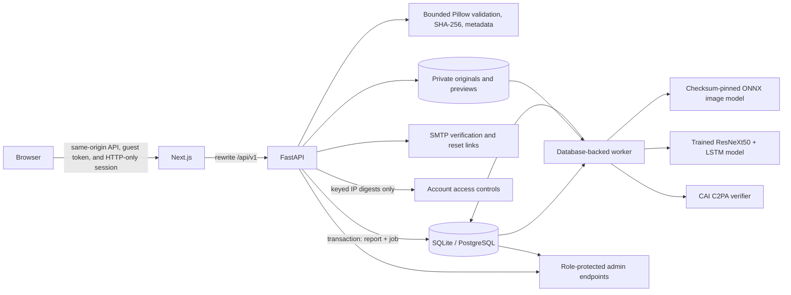

# Architecture

## Trust boundaries and processing flow

1. Registered users receive opaque HTTP-only sessions; only their SHA-256 token digests are stored. Passwords use Argon2id. New accounts must verify their email before analysis.
2. A visitor without a valid account session receives a signed, opaque, HTTP-only guest cookie. The database stores the guest ID and timestamps; it does not store a browser fingerprint or guest usage quota. Proxy-derived IPs are accepted only from configured trusted CIDRs.
3. The upload route applies persistent request rate limits and account/IP access controls, then performs bounded content validation. Pillow validates still images; the video path checks content, decodability, dimensions, and configured duration. The report and queued inference job are inserted before the same transaction commits. There is no balance check or per-analysis charge.
4. Guest reports are visible through the signed guest identity and move to the account when that guest registers.
5. The worker claims jobs with a conditional database update and a lease. A crashed worker's expired lease can be recovered by a later worker. Retries use bounded exponential backoff; exhausted jobs are marked failed without any balance adjustment.
6. The worker records model output and C2PA verification independently. A detector error does not erase successful integrity/provenance observations. No remote inference service receives the media.
7. Every report, preview, deletion, and admin action is authorized server-side. User-owned report queries include the authenticated user ID or guest ID. Admin routes check the role on the API; hidden routes and noindex metadata are only additional controls.

## Durable jobs

`InferenceJob` is persisted beside the `Analysis` row. Its state includes `queued`, `processing`, `completed`, or `failed`, attempts, availability time, lease expiry, worker ID, and a safe last-error code. Worker ownership is recorded with an expiring lease. A conditional `UPDATE ... WHERE status/lease still eligible` ensures only one worker claims a given job. SQLite and PostgreSQL are supported. No in-process FastAPI background task is relied upon for durable work.

The local SQLite setup is intended for a single host. PostgreSQL is the production database option; production deployments should run one or more isolated worker processes and monitor queue depth, lease recovery, retry volume, and failed jobs.

## Rate limiting

Signup, login, upload, and unblock-request traffic use fixed-window counters stored in `rate_limit_buckets`. SQLite/PostgreSQL upserts increment counters atomically across API processes. Database keys are HMAC digests, not raw IP addresses or session tokens. The app uses the direct network peer unless it is in `TRUSTED_PROXY_CIDRS`; only then does it accept a forwarded client address from the trusted chain. A reverse proxy should enforce its own edge limits; if traffic shares a proxy address and is not explicitly trusted, API limits will conservatively aggregate at that address.

## Access controls

Analysis access has no point balance, guest analysis allowance, or per-analysis charge. Email verification for registered users, upload validation, persistent request rate limits, and account/IP security controls remain active. `MAX_ACCOUNTS_PER_IP` counts distinct linked user IDs. Only keyed IP hashes appear in application records or admin output. Soft account blocks preserve access for already-linked accounts; hard mode denies all access from the IP until an administrator acts.

## Domain model

- `User`: normalized email identity, display name, Argon2 hash, verification/reset token digests and expiries, role, enabled state, creation time.
- `UserSession`: token digest, user ID, expiry, revocation time.
- `GuestSession`: signed-cookie identity, linked user, and creation/last-seen timestamps.
- `Analysis`: either a user owner or guest owner, idempotency key, file facts/hash, private object keys, status, technical metadata, detector output, C2PA summary, timestamps.
- `IpAccountLink`, `IpBlock`, `IpWhitelist`, `UnblockRequest`, `AccessAuditEvent`: hashed-IP account enforcement, owner resolution flow, and privacy-preserving access audit.
- `InferenceJob`: durable processing state, attempt count, lease, retry time, worker ID, safe error code.
- `RateLimitBucket`: HMAC key digest, request count, reset epoch.
- `AuditEvent`: administrator actor, action, subject, non-sensitive detail JSON, timestamp.
- `WorkerHeartbeat`: worker ID, process ID, last-seen time for actual admin health state.

Migrations are managed with Alembic. The local launcher applies them before starting services.

## Components

- `apps/web`: Next.js App Router, React, TypeScript, dark/light themes, private workspace, admin sign-in/console, Playwright suite.
- `apps/api`: FastAPI, SQLAlchemy, Alembic, Argon2id, bounded image validation, API authorization, persistent rate limits.
- `apps/api/app/worker.py`: lease-based database worker and retry handling.
- `apps/api/app/detectors.py`: provider contract, hash-verifying ONNX CPU adapter, and test-only fixture.
- `apps/api/app/temporal_detector.py`: checkpoint-validated ResNeXt50 + LSTM video inference; scores are withheld unless trained weights load successfully.
- `apps/api/app/scanner.py`: official C2PA Python SDK integration with privacy-conscious report summaries.
- `apps/api/storage/`: local private originals and previews; not served as a static web directory.
- `run.ps1`: root development launcher for migrations, API, worker, and frontend.

## Operational caveats

The C2PA SDK is an install-time dependency. If unavailable, reports distinguish that from a file with no credentials. The image artifact SHA-256 is verified before use. The video checkpoint is gated by its publisher and requires Hugging Face access approval plus a read token; without a validated checkpoint, Layer 2 reports unavailable and emits no temporal score. Migration `0006_retire_credits` removes balances from the live schema and renames the former ledger tables outside the application mappings so existing records are preserved. PostgreSQL applies forced row-level security with no runtime policy to the archive; direct database access to the legacy SQLite tables remains an operator-level capability. The default `UPLOAD_RETENTION_DAYS=0` keeps original uploads until report/account deletion; if configured above zero, the worker removes media and completed/failed reports after the configured age. Backup deletion is managed by deployment operations. Print-to-PDF is browser-side; there is no server-generated PDF job.
